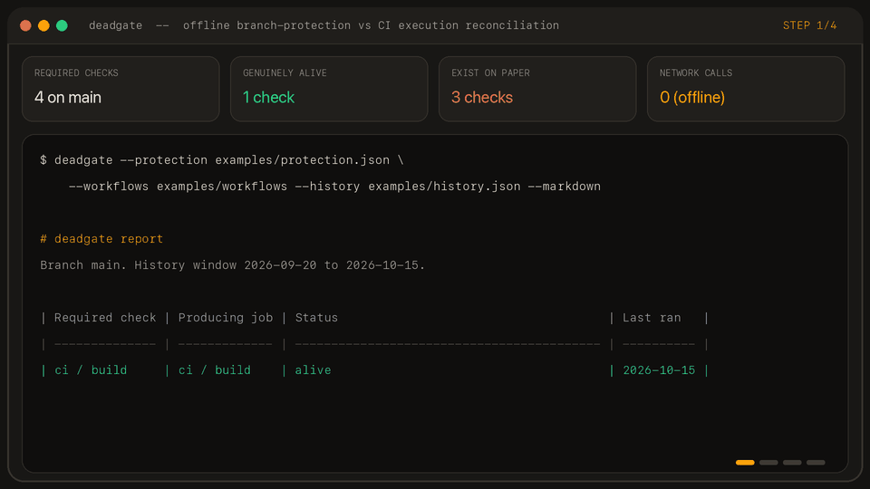
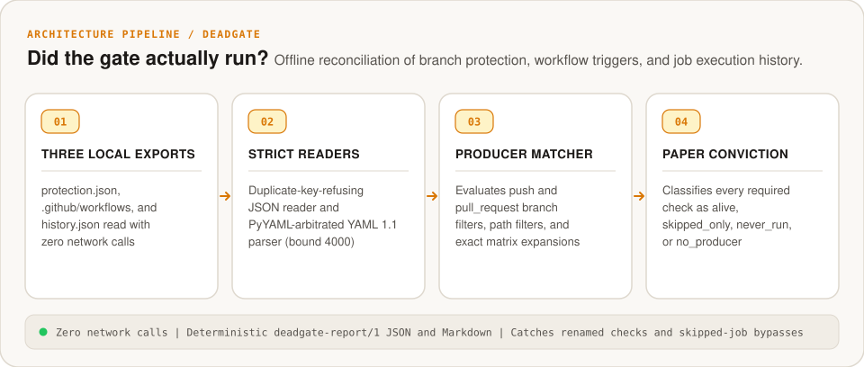
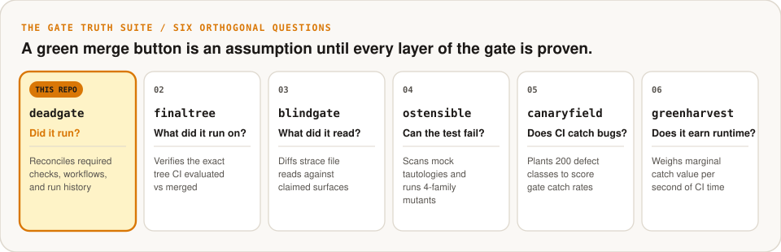

<p align="center">
  <a href="https://github.com/david-engelmann/deadgate">
    <picture>
      <source media="(prefers-color-scheme: dark)" srcset="https://raw.githubusercontent.com/david-engelmann/deadgate/main/docs/media/deadgate-lockup-dark.svg">
      
    </picture>
  </a>
</p>

<h3 align="center">Reconcile required branch-protection checks against workflow definitions and actual CI run history.</h3>

<p align="center">A required status check can enforce nothing for weeks after a job rename, a skipped <code>if</code> condition, or a path-filtered trigger while the merge button stays green. <code>deadgate</code> compares local exports of branch protection, <code>.github/workflows</code>, and job history with zero network calls, naming every check that exists only on paper alongside the last date it actually ran.</p>

<p align="center">
  <a href="https://github.com/david-engelmann/deadgate/blob/main/docs/GUIDE.md"><b>Operator Guide</b></a> |
  <a href="https://david-engelmann.github.io/deadgate/">Published Docs</a> |
  <a href="https://github.com/david-engelmann/deadgate/tree/main/examples">Examples</a> |
  <a href="https://github.com/david-engelmann/deadgate/blob/main/docs/ARCHITECTURE.md">Architecture</a> |
  <a href="https://github.com/david-engelmann/deadgate/blob/main/docs/FORMATS.md">Wire Formats</a> |
  <a href="https://github.com/david-engelmann/deadgate/blob/main/docs/COMPARISON.md">Comparison</a> |
  <a href="https://github.com/david-engelmann/deadgate/blob/main/docs/FAQ.md">FAQ</a> |
  <a href="https://github.com/david-engelmann/deadgate/releases">Releases</a>
</p>

<p align="center">
  <a href="https://github.com/david-engelmann/deadgate/actions/workflows/ci.yml"></a>
  <a href="https://david-engelmann.github.io/deadgate/"></a>
  <a href="https://github.com/david-engelmann/deadgate/blob/main/Cargo.toml"></a>
  <a href="https://github.com/david-engelmann/deadgate/blob/main/LICENSE"></a>
</p>

<p align="center">
  
</p>

<p align="center"><sub>Every terminal line above comes from running the deadgate release binary against examples/.</sub></p>

## What this is

A required check can enforce nothing for weeks after a rename while the merge button stays green the whole time, and skipped jobs reporting success is a second documented variant of the same break. No CI platform self-tests that a bad pull request still gets refused. Deadgate compares the three sources of truth, protection settings, workflow definitions, and execution history, and names the checks that exist only on paper. The boundary with its siblings is one sentence. Deadgate asks whether it ran, finaltree asks what it ran on, blindgate asks what it read.

<p align="center">
  <picture>
    <source media="(prefers-color-scheme: dark)" srcset="https://raw.githubusercontent.com/david-engelmann/deadgate/main/docs/media/how-it-works-dark.svg">
    
  </picture>
</p>

## Install

Install a prebuilt binary on Linux or macOS (`x86_64` and `aarch64`) with the checksum-verifying installer script.

```sh
curl -fsSL https://raw.githubusercontent.com/david-engelmann/deadgate/main/install.sh | sh
export PATH="$HOME/.local/bin:$PATH"
```

Or install via `cargo-binstall` or from source with Cargo (Rust 1.80 or newer).

```sh
cargo binstall --git https://github.com/david-engelmann/deadgate deadgate
cargo install --git https://github.com/david-engelmann/deadgate --locked
```

From a local checkout, `cargo build --release --locked` leaves the binary at `target/release/deadgate` (Windows `.zip` archives ship on the [Releases](https://github.com/david-engelmann/deadgate/releases) page).

## Quickstart

Run `deadgate` over the synthetic exports under `examples/` to emit either the Markdown table (`examples/report.md`) or the default `deadgate-report/1` JSON document (`examples/report.json`).

```sh
deadgate \
  --protection examples/protection.json \
  --workflows examples/workflows \
  --history examples/history.json \
  --markdown
```

```markdown
# deadgate report

Branch main. History window 2026-09-20 to 2026-10-15.

| Required check | Producing job | Status | Last ran |
| --- | --- | --- | --- |
| ci / build | ci / build | alive | 2026-10-15 |
| ci / lint | ci / lint | skipped only (job carries an if condition) | never |
| ci / package | none | no producer | 2026-09-20 |
| tests / test | tests / test | never ran (path filtered trigger) | never |
```

Omit `--markdown` to emit the deterministic `deadgate-report/1` JSON report, and pass `--branch <name>` when auditing a branch other than `main`.

## Exporting Inputs from GitHub

Deadgate makes zero network calls and reads only local files. Export branch protection and paginated job history from a GitHub repository inside an isolated subshell with `gh` and `jq`, then hand the files to `deadgate`.

```sh
(
  set -eu
  REPO="owner/repo"
  BRANCH="main"

  gh api "repos/$REPO/branches/$BRANCH/protection" > protection.json

  gh api "repos/$REPO/actions/runs?branch=$BRANCH&per_page=30" \
    --jq '.workflow_runs[] | "\(.id)\t\(.name)"' > runs.tsv

  cp /dev/null jobs.jsonl
  while IFS="$(printf '\t')" read -r RUN_ID WF_NAME; do
    gh api --paginate "repos/$REPO/actions/runs/$RUN_ID/jobs?per_page=100" > run-jobs.json
    jq -c --arg wf "$WF_NAME" '.jobs[] | .workflow_name = (.workflow_name // $wf)' run-jobs.json >> jobs.jsonl
  done < runs.tsv
  rm -f runs.tsv run-jobs.json
  jq -s '{jobs: .}' jobs.jsonl > history.json
  rm -f jobs.jsonl

  deadgate \
    --protection protection.json \
    --workflows .github/workflows \
    --history history.json \
    --branch "$BRANCH" \
    --markdown
)
```

## Benchmarks and Verification

Run the full local gate from a clean checkout.

```sh
cargo test --locked
cargo fmt --check
cargo clippy --offline --all-targets
cargo package --locked
```

Measured with the `--release` binary on synthetic workflow and history snapshots.

| Workload | Input shape | Mean elapsed |
| --- | --- | --- |
| `examples/` reconciliation | `4` required checks, `2` workflows, `2` job records | `13.9 ms` |
| Enterprise monorepo snapshot | `40` workflow YAML files, `160` required checks, `1,920` job history records | `126.1 ms` |

## The Gate Truth Suite

<p align="center">
  <picture>
    <source media="(prefers-color-scheme: dark)" srcset="https://raw.githubusercontent.com/david-engelmann/deadgate/main/docs/media/gate-truth-arc-dark.svg">
    
  </picture>
</p>

| Tool | Question answered | Primary evidence |
| --- | --- | --- |
| [deadgate](https://github.com/david-engelmann/deadgate) | Did the required check actually run? | Branch protection, workflow YAML, and job history |
| [finaltree](https://github.com/david-engelmann/finaltree) | What tree did CI actually evaluate? | Commit and tree lineage across merge queues |
| [blindgate](https://github.com/david-engelmann/blindgate) | What files did the gate actually read? | Linux `strace` descriptor and path reconstruction |
| [ostensible](https://github.com/david-engelmann/ostensible) | Can the test actually fail? | Static tautology scan and 4-family `pytest` mutants |
| [canaryfield](https://github.com/david-engelmann/canaryfield) | Does the harness catch planted defects? | 200 seeded Python defect classes across real gates |
| [greenharvest](https://github.com/david-engelmann/greenharvest) | Which tests earn their CI runtime? | Marginal defect-catch value per second of execution |

## Documentation

| If you want to... | Read |
| --- | --- |
| Browse the searchable handbook with diagrams | [Published documentation](https://david-engelmann.github.io/deadgate/) |
| Install, configure CI workflows, and run day-two operations | [Operator Guide](https://github.com/david-engelmann/deadgate/blob/main/docs/GUIDE.md) |
| Understand parser bounds, engine phases, and containment invariants | [Architecture](https://github.com/david-engelmann/deadgate/blob/main/docs/ARCHITECTURE.md) |
| Integrate JSON or text schemas into downstream tooling | [Wire Formats](https://github.com/david-engelmann/deadgate/blob/main/docs/FORMATS.md) |
| Compare `deadgate` against existing linters, coverage, and mutators | [Comparison](https://github.com/david-engelmann/deadgate/blob/main/docs/COMPARISON.md) and [FAQ](https://github.com/david-engelmann/deadgate/blob/main/docs/FAQ.md) |
| Review threat boundaries, vulnerability reporting, and contribution gates | [Security Policy](https://github.com/david-engelmann/deadgate/blob/main/SECURITY.md) and [Contributing](https://github.com/david-engelmann/deadgate/blob/main/CONTRIBUTING.md) |

## Status

Seed is done and the seed commit sits on the local main branch. The contract in CONTRACT.md holds the obligations for this repo, and the seed concept stands as slice 1.

Slice 2 is built on a local branch as the Round 1 work increment. The slice 2 obligations in CONTRACT.md are met by the test suite. Deadgate ingests a branch protection export, a folder of workflow definitions, and an execution history export, all as local files and with no network call at any point, and it reconciles every required status check against the jobs that can produce it for the branch and the records those jobs left behind in the history window. A check that ran to a conclusion reads alive with its last run date, and a check that exists only on paper is named in one of the three paper kinds, no producer, never ran, or skipped only. The rename case reads no producer with the stale date of its last run under the old name standing beside it as the evidence. The two skip shapes are told apart, because a job skipped inside a firing workflow satisfies the requirement without running and reads skipped only, while a path filtered trigger creates no run at all and its check reads never ran with the note standing on it. The report renders as JSON under the format name deadgate-report/1 and as a markdown table from the same facts, deterministic byte for byte on the same inputs, and a committed example under examples shows one check of each kind. AGENTS.md stands in this repo, the canonical template of the program with this repo's annex below its marked line. Pinned formats stand at deadgate-report/1. The Round 1 review fixes recorded in CONTRACT.md tighten the readings the two reviews found loose, so a run now counts toward a check only from the workflow that produces it, a matrix combination counts only in the exact form the matrix generates, branch filters follow the GitHub filter pattern rules in the order they are written, a written filter is never read as no filter, and the path filtered note stands only on a never ran check whose absence the filter explains.

Closed rounds stand at 26 of 100. Round 1 closed after audit and two-axis review and red team and owner approval, with the review fixes landed on the same branch.

Round 2 is built on a local branch with its reviews and its fix pass complete. Both review axes approved the port, and the red team returned a reject on the YAML reader that the fix pass closed, a stack abort inside the stated nesting bound, a signed point first float family, indicator led tokens in flow position, a byte order mark standing in a workflow name, and nine minors across the readers, each now pinned by recorded witnesses. The duplicate key refusal of the Round 2 amendment stands in the Python package, and the first Rust port slice stands beside it as the crate at the repo root, carrying the three ingestions and the reconciliation and both report renderings behind a binary with the flags of the Python command. The port is held to the Python reading by a conformance suite recorded from it, and the Python package stands as its behavioral specification.

Round 3 is built on a local branch with its reviews complete. The closing slice of the Rust port stands landed in the tree: the binary carries the Python command line whole behind its one flat argument surface, and the Python package and its suite stand retired, so the repo is Rust whole. A recorded command line battery drawn from the Python holds the shell to the Python's answers byte for byte, and the standing recorded conformance holds the core the same way. The readers' nesting bound of 4000 stands as a stated port limit where the Python reads deeper in the JSON documents, and the deep workflow reading the Python dies on stands as the YAML reader's stated direction from the first port slice. The committed examples regenerate byte identical through the new binary.

Round 4 is built on a local branch with its reviews complete. The block scalar slice of Rust port slice 3 stands landed in the tree: the YAML reader reads literal and folded block scalars standing in block position, under the header grammar and the indentation and chomping rules PORT3 states, with the tab standing and the document apparatus standing position aware against block content, and the borders of the lift, a block head in flow position or behind an anchor or a tag or standing as a key, refused as they stood. The slice is proven by a corpus recorded from PyYAML 6.0.1 with the generator the repo keeps under tools, and by the pins of PORT3-1 to PORT3-9 standing in the suite.

Round 5 is built on a local branch with its reviews complete. The anchor, alias, and tag slice of Rust port slice 4 stands landed in the tree: the YAML reader reads anchors and aliases and merge keys and tags as PyYAML 6.0.1 reads them, under the positions and borders PORT4 states, with aliases standing as charged copies counted against the expansion bound and the key position family standing refused. The slice opened by carrying the seventeen fix pass names of Round 4 into the PORT3 proof lists, the name map, and the census, and it closes with the contract census at 188 and the recorded battery at 593 cases, proven by the generator at tools/gen_port4_recordings.py and the 45 pins of PORT4-1 to PORT4-9 standing in tests/anchors_tags.rs.

Round 6 is built on a local branch with its reviews complete. The explicit key slice of Rust port slice 5 stands landed in the tree: the YAML reader reads explicit keys in block mappings and in flow mappings as PyYAML 6.0.1 reads them, the key node standing on the question mark line or on the lines behind a bare mark, with a block scalar standing as a key among the readings and the merge key merging in its explicit spelling, and a scalar standing on the lines behind the line that carries its tag converting from its own text under the tag on both reading paths, repairing the divergence the fifth round carried as named debt. The slice closes with the contract census at 205 and the recorded battery at 640 cases, proven by the generator at tools/gen_port5_recordings.py and the seventeen pins of PORT5-1 to PORT5-7 standing in tests/explicit_keys.rs.

Part of the impatient programming portfolio, in the Gate Truth arc.

## Licence

MIT. See LICENSE.
