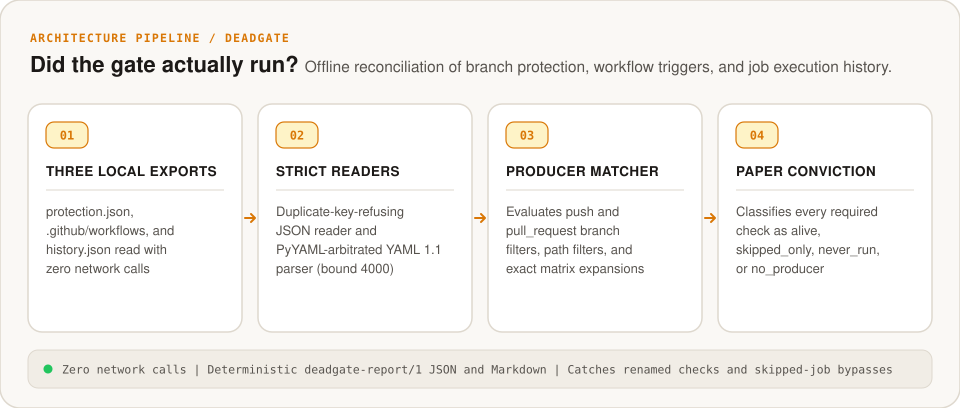
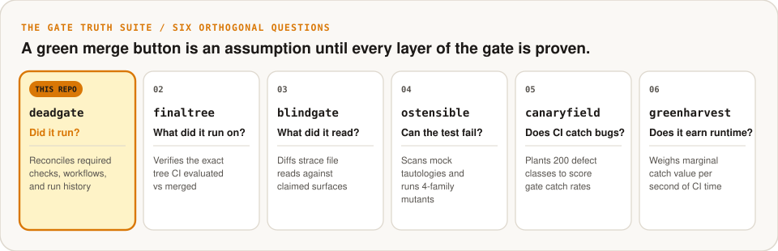

# Deadgate Architecture

Deadgate asks whether each required status check guarding a protected branch actually runs in CI or exists only on paper. Built as a zero-dependency, zero-network pure-Rust crate (`src/`), Deadgate ingests local snapshots of branch protection, `.github/workflows`, and job execution history to convict orphaned renames, path-filtered blind spots, and skipped-only jobs.

  <picture>
    <source media="(prefers-color-scheme: dark)" srcset="https://raw.githubusercontent.com/david-engelmann/deadgate/main/docs/media/how-it-works-dark.svg">
    
  </picture>

## Pipeline Stages

### 1. Strict JSON Reader (`src/jsonvalue.rs`)

Branch-protection exports and job-history exports are parsed with Deadgate's strict pure-Rust JSON reader. Duplicate object keys at *any* nesting depth are refused immediately with exit code `2` (preventing silent key-shadowing ambiguities in security settings), and nesting depth is bounded at `4000`.

### 2. PyYAML-Arbitrated YAML 1.1 Workflow Reader (`src/yaml.rs`)

GitHub Actions workflows routinely rely on YAML 1.1 features including literal and folded block scalars (`|` and `>`), anchors (`&`), aliases (`*`), merge keys (`<<`), tags, and explicit mapping keys (`?`). Deadgate implements a pure-Rust YAML 1.1 reader proven against recorded PyYAML 6.0.1 corpora, charging alias and merge expansions against an explicit `4000` expansion bound so billion-laughs inputs fail closed.

### 3. Trigger, Filter, and Matrix Producer Expansion (`src/ingest.rs`)

For each `.yml` and `.yaml` workflow file in filename order, Deadgate evaluates `on` triggers (`push` and `pull_request` branch filters under GitHub's exact ordered positive/negative pattern semantics, plus `paths` and `paths-ignore` filters) and expands `strategy.matrix` dimensions alongside `include` and `exclude` rules to compute the exact job contexts (`<job>` and `<workflow> / <job>`) producible for `--branch`.

### 4. Four-Verdict Reconciler and Deterministic Renderers (`src/reconcile.rs`, `src/report.rs`)

Each deduplicated required check context is matched against producing workflows and completed history records within the history window, receiving one of four statuses (`alive`, `skipped_only`, `never_run`, or `no_producer`) plus diagnostic notes (`"path filtered trigger"` and `"job carries an if condition"`), rendered byte-for-byte deterministically as `deadgate-report/1` JSON or a Markdown table.

  <picture>
    <source media="(prefers-color-scheme: dark)" srcset="https://raw.githubusercontent.com/david-engelmann/deadgate/main/docs/media/gate-truth-arc-dark.svg">
    
  </picture>

