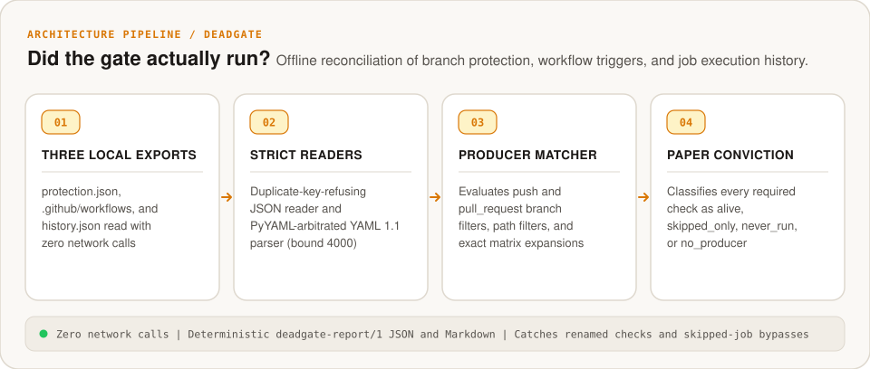
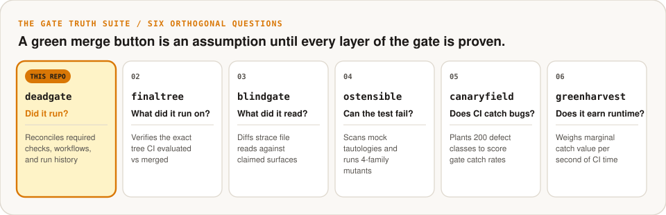

# deadgate Documentation

Deadgate asks whether required branch-protection checks actually ran in CI by reconciling offline protection settings, workflow YAML triggers, and job execution history.

  <picture>
    <source media="(prefers-color-scheme: dark)" srcset="https://raw.githubusercontent.com/david-engelmann/deadgate/main/docs/media/how-it-works-dark.svg">
    
  </picture>

## Handbook Contents

- [Operator Guide](GUIDE.md) Step-by-step installation, CLI flags, environment preparation, and copy-pasteable GitHub Actions workflows.
- [Architecture](ARCHITECTURE.md) Internal pipeline stages, pure-Rust parser bounds, isolation invariants, and Gate Truth suite boundaries.
- [Wire Formats](FORMATS.md) Deterministic JSON and human-readable report schemas, status enumerations, and stability rules.
- [Comparison](COMPARISON.md) Technical comparison against traditional coverage, linters, mutation frameworks, and sibling Gate Truth tools.
- [FAQ](FAQ.md) Direct answers to common engineering, performance, and CI adoption questions.
- [Changelog](../CHANGELOG.md) Release milestone summaries.
- [Security Policy](../SECURITY.md) Execution model and private vulnerability reporting.
- [Contributing](../CONTRIBUTING.md) Contract-first development rules and exact-final-head local gates.

  <picture>
    <source media="(prefers-color-scheme: dark)" srcset="https://raw.githubusercontent.com/david-engelmann/deadgate/main/docs/media/gate-truth-arc-dark.svg">
    
  </picture>

